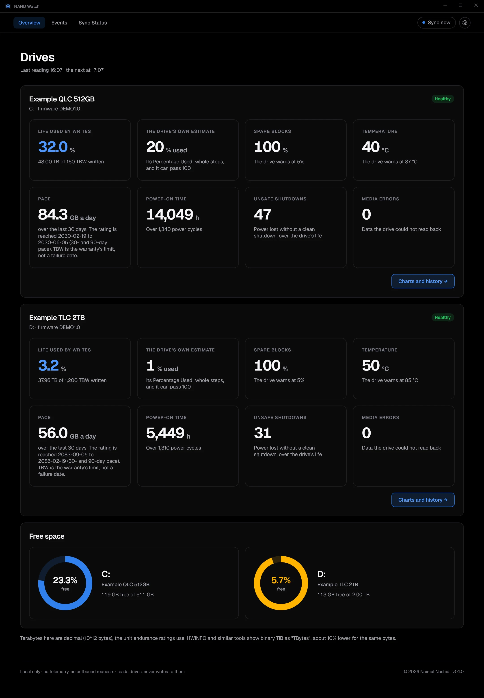
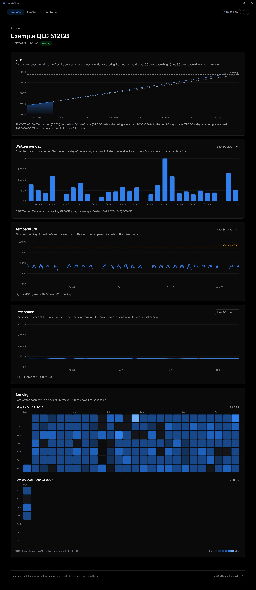
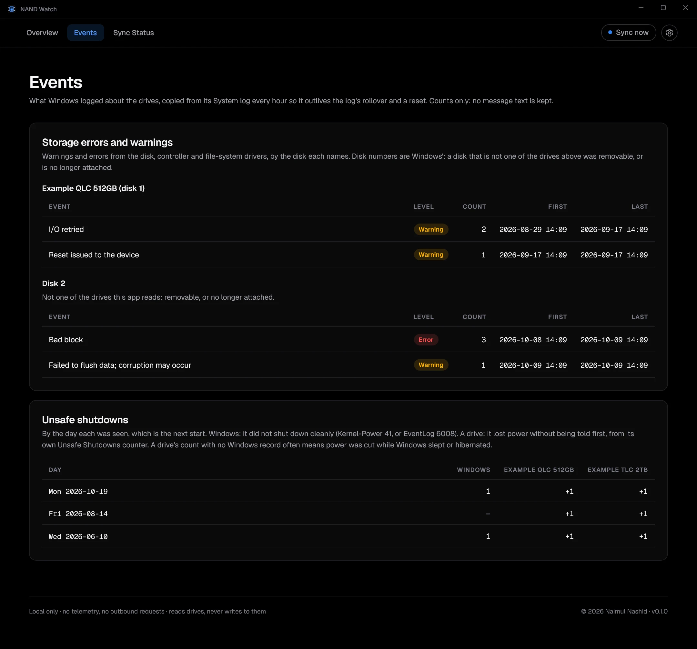
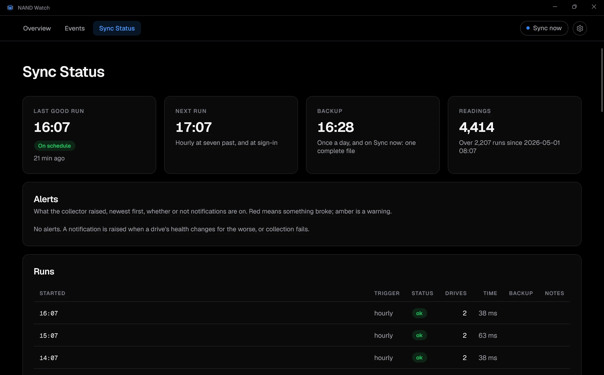
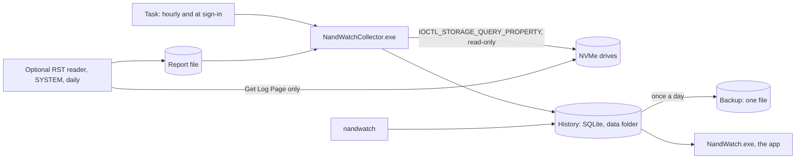

#  NAND Watch

[](https://github.com/naimulnashid/nand-watch/actions/workflows/ci.yml)
[](https://github.com/naimulnashid/nand-watch/releases/latest)
[](LICENSE)

A Windows app that keeps a permanent history of each NVMe drive's own health
counters (bytes written, wear, spare blocks, temperature, errors) and turns it
into a life estimate, a projected end date and alerts. Local only: no network
calls, no account.

## Screenshots

Every figure below is invented: two "Example" drives from `nandwatch
demo-data`, nobody's real drives. `tools\Capture-Readme.ps1` makes them again
when the app changes. Each shows in the theme your GitHub is set to.

<details open>
<summary><b>Overview</b>: each drive's life used, health and pace; free space as rings</summary>

<picture>
  <source media="(prefers-color-scheme: light)" srcset="docs/screenshots/overview-light.webp">
  
</picture>

</details>

<details>
<summary><b>A drive's charts</b>: life against the rating with the pace drawn ahead, written per day, temperature, free space, and a calendar of writes</summary>

<picture>
  <source media="(prefers-color-scheme: light)" srcset="docs/screenshots/drive-light.webp">
  
</picture>

</details>

<details>
<summary><b>Events</b>: Windows' storage warnings and errors by disk, and unsafe shutdowns by day</summary>

<picture>
  <source media="(prefers-color-scheme: light)" srcset="docs/screenshots/events-light.webp">
  
</picture>

</details>

<details>
<summary><b>Sync Status</b>: the last and next runs, the backup, alerts and the run log</summary>

<picture>
  <source media="(prefers-color-scheme: light)" srcset="docs/screenshots/sync-light.webp">
  
</picture>

</details>

## Features

- **An hourly history of every NVMe drive**, collected by a scheduled task
  that runs as you, without administrator rights and without a window. Each
  reading takes well under a second and keeps the drive's counters as it
  reported them, with the raw health page.
- **Two life figures, side by side**: data written against the drive's
  rated endurance (TBW), and the drive's own wear estimate. Never blended.
- **A projected end date** as a range, from the last 30 and 90 days of use,
  once there are two weeks of history.
- **A page of charts per drive**: data written against its rating with the
  pace drawn ahead to where it reaches it; written per day, with days the PC
  was off shown as off and days nothing was recorded shown as unknown, never
  as zero; temperature against the drive's warning; free space; and a
  calendar heat map of each day's writes. Each chart has its own range.
- **Free space** of every volume, as a ring that turns amber below 10% free.
- **Notifications** when a drive's health changes for the worse (a critical
  warning, spare running out, media errors, overheating, wear passing 80, 90
  and 100%) or collection fails, from the hourly task itself: nothing needs
  to stay running. Each problem is announced once, and every alert is kept.
- **Events**: storage warnings and errors from Windows' System log, grouped
  by disk, and unsafe shutdowns by day, Windows' record beside each drive's
  own count. Copied every hour, so they outlive the log.
- **Works behind Intel RST / VMD** for every drive whose health log Windows'
  storage driver will pass on, and records temperature, free space and the
  error log for those it will not. For those, an optional reader fetches the
  health log once a day (see [Intel RST](#intel-rst)).
- **A daily backup** of the history as one self-contained file, in a folder a
  cloud client can sync, so the history outlives a Windows reset.
- **Dark, light or Windows' theme**, zoom with Ctrl+Plus and Ctrl+Minus, an
  optional tray icon, pages that refresh when a reading lands.
- **A command line** (`nandwatch`) for the history and for diagnostics:
  `probe` reports how each drive can be read on this PC; `read` decodes one
  drive's health log.

## Installation and getting started

Requirements: Windows 10 version 2004 (build 19041) or later, or Windows 11,
on x64, with at least one NVMe drive. SATA and USB drives are listed as not
supported yet.

**From a release** (nothing else to install): download
`NandWatch-<version>-win-x64.zip` from
[Releases](https://github.com/naimulnashid/nand-watch/releases), extract it,
and in PowerShell, inside the extracted `NAND Watch` folder:

```powershell
powershell -ExecutionPolicy Bypass -File .\Install.ps1
```

**From source**, with the [.NET 10 SDK](https://dotnet.microsoft.com/download)
(10.0.100 or later), in PowerShell from a clone:

```powershell
powershell -ExecutionPolicy Bypass -File tools\Install.ps1
```

Either way it installs the app and the collector into
`%LOCALAPPDATA%\Programs\NAND Watch` and the command line into its `cli`
subfolder, adds **NAND Watch** to the Start menu and to Settings > Apps >
Installed apps, sets the data folder, registers the hourly task and runs a
first collection. No administrator approval is needed.

**Keep the data folder off the Windows drive**, ideally in a folder a cloud
client backs up: that is what makes the history survive a reset. The default
is `D:\PersistentData\nand-watch`; choose another with `-DataDir`. If that
drive does not exist, or is the Windows drive, nothing is set and the app
asks for a folder when it first opens.

**Uninstall** from Installed apps, or with `Install.ps1 -Uninstall`. The
history in the data folder is never deleted; `-RemoveData` also removes
`%LOCALAPPDATA%\NAND Watch` (the pointer to the data folder, the settings
and the logs).

**After a Windows reset**, install again with `-DataDir` pointing at the same
folder. The drives keep their own lifetime totals, and the history continues
where it stopped.

## Configuration

No configuration file to edit. The installer (or the app's first-run screen)
writes `%LOCALAPPDATA%\NAND Watch\location.json`, which names the data
folder; the app's settings are in `app-settings.json` beside it. Two
environment variables override the folders, for trying things on an invented
history; set both, or the real folders are used:

| Variable | Moves |
|---|---|
| `NANDWATCH_DATA_DIR` | The data folder (database and backup) |
| `NANDWATCH_LOCAL_DIR` | The local folder (`location.json`, settings, logs) |

No API keys, accounts or network settings: NAND Watch makes no network
requests.

## Usage

Open **NAND Watch** from the Start menu. It reads the drives when it opens;
**Sync now** reads them again and writes the backup. **Charts and history**
on a drive's panel opens its page of charts. The settings menu (the gear) has
the theme, zoom, notifications, the optional tray and start at sign-in, and
the data and log folders.

The installed command line is `%LOCALAPPDATA%\Programs\NAND Watch\cli\nandwatch.exe`.

```powershell
$nw = "$env:LOCALAPPDATA\Programs\NAND Watch\cli\nandwatch.exe"
& $nw stats              # each drive: latest reading, life used, pace, written per day, free space, recent runs
& $nw stats --days 30    # a longer daily line
& $nw collect            # collect now, as the hourly task does
& $nw where              # where the data, backup and logs are
& $nw read               # decode every drive's health log now
& $nw probe              # how each drive can be read on this PC
& $nw alerts             # the alerts raised, newest first
& $nw notify-test        # show one sample notification
& $nw rst-show           # decode the Intel RST reader's latest report
```

In the daily line, `?` is a day with no reading, `off` a day the drive was
off, and `*` a day whose total includes writes from earlier, unrecorded hours.

**Try it on invented data**, without touching the real history:

```powershell
& $nw demo-data $env:TEMP\nandwatch-demo
$env:NANDWATCH_DATA_DIR = "$env:TEMP\nandwatch-demo\data"
$env:NANDWATCH_LOCAL_DIR = "$env:TEMP\nandwatch-demo\local"
& $nw stats
```

### Intel RST

Behind Intel RST (VMD), Windows passes some drives' health log on to a
standard account and refuses others. For those, an optional reader asks RST
directly, once a day. It is the only part of NAND Watch that runs with
administrator rights, so it is installed only when asked for, and it sends
each drive one command: Get Log Page for the health log.

Check what it reads first. In a release, the reader is
`rst\NandWatchRstReader.exe`; from a clone, build it as yourself (building
elevated would leave files in the clone that only an administrator can
change):

```powershell
dotnet publish src\NandWatch.RstReader -c Release -o C:\Temp\rst
```

Then, from an **elevated** terminal, run it once, and read what it wrote from
any terminal:

```powershell
& C:\Temp\rst\NandWatchRstReader.exe --out C:\Temp\rst\out
& $nw rst-show C:\Temp\rst\out\rst-health.json   # compare with HWiNFO or CrystalDiskInfo
```

Delete `C:\Temp\rst` afterwards: the raw report holds the drives' identifiers.
Then install it by running the installer again with `-RstReader` (one
administrator approval). It goes under `%ProgramFiles%\NAND Watch`, runs as
SYSTEM daily at 12:37, and **Read health log now** in the app runs it at
once. Uninstalling removes it, with one more approval.

### Why the figures can differ from other tools

HWiNFO and similar tools label binary units "TBytes" (2^40 bytes). NAND Watch
uses decimal terabytes (10^12 bytes), the unit drive endurance ratings are
stated in, so the same drive reads about 10% higher here.

## Tech stack and architecture

C# on .NET 10, WinUI 3 (Windows App SDK) for the app, SQLite through
Microsoft.Data.Sqlite.



- `NandWatch.Core` (plain .NET, no Windows APIs): the NVMe parsers, the
  history's schema, every calculation and every chart's range. Tested on any
  OS.
- `NandWatch.Windows`: the only code that calls Windows (`DeviceIoControl`
  on `\\.\PhysicalDriveN`, WMI, the event log, notifications) and the
  collector.
- `NandWatch.exe`, the app (WinUI 3, built entirely in code);
  `NandWatchCollector.exe`, what the task runs; `nandwatch`, the command
  line; `NandWatchRstReader.exe`, the optional reader.

Drives are read through Windows' own storage driver: no extra driver is
installed.

## Security and privacy

- **Read-only.** The code can send a drive only Identify and Get Log Page
  requests, which change nothing. It never uses the pass-through interfaces
  that can send arbitrary commands, and a test fails the build if one appears.
- **No administrator rights**: the task runs as you, unelevated. The one
  exception is the optional Intel RST reader (above), installed only when you
  ask, which sends a drive one command, Get Log Page, and is checked by a
  test that fails the build if it could send anything else.
- **Registry**: per user only. Notifications need an identity
  (`HKCU\Software\Classes\AppUserModelId\NaimulNashid.NandWatch`) and a
  `nandwatch:` link that opens the app when one is clicked; the link carries
  no command. Start at sign-in, when turned on, is a value under the Run key.
  Uninstalling removes all three.
- **Nothing leaves the PC.** No network access of any kind. The history is a
  local SQLite database; it is not encrypted, so it is as private as the
  folder it is in (and the cloud service syncing that folder, if any).
- **What is stored**: each drive's model, firmware and Windows' identifier
  for it, its health counters, temperatures and the free space of its
  volumes, and counts of Windows' storage events (never their message text).
  No file names, no file contents, nothing about what you use the PC for.
- **Serial numbers** are masked in what the command line prints. The probe's
  raw `.bin` pages and the RST reader's report hold them in full: do not
  share those publicly.

To report a vulnerability, see [SECURITY.md](SECURITY.md).

## Development

From the repo root, in any shell. The whole solution, the app included, also
compiles on Linux and macOS as a check; the app and the collector only run on
Windows:

```bash
dotnet build NandWatch.slnx -c Release
dotnet test --project tests/NandWatch.Core.Tests/NandWatch.Core.Tests.csproj
```

Warnings are errors. Tests use invented pages and throwaway databases in the
temp folder. `nandwatch demo-data` makes an invented history to work against.

On Windows, in PowerShell from the repo root:

```powershell
powershell -ExecutionPolicy Bypass -File tools\Package-Release.ps1   # the release zip, in artifacts\
powershell -ExecutionPolicy Bypass -File tools\Capture-Readme.ps1   # the README's screenshots, from invented data
```

## Contributing, license and support

Contributions are welcome: see [CONTRIBUTING.md](CONTRIBUTING.md). Licensed
under the [MIT License](LICENSE). Third-party notices are in
[THIRD-PARTY-NOTICES.md](THIRD-PARTY-NOTICES.md). Report problems in the
[issue tracker](https://github.com/naimulnashid/nand-watch/issues).
